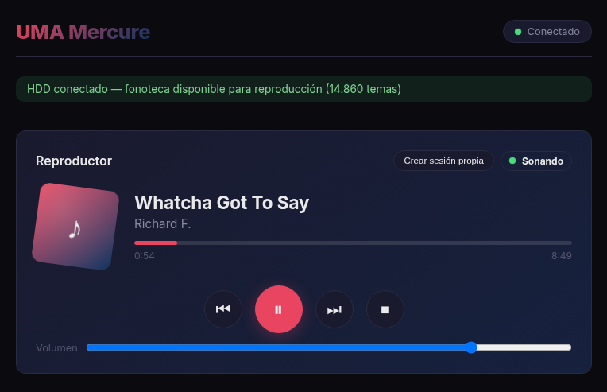

# UMA Mercure

Radio personal autohosteada: una webapp que sirve tu fonoteca (14k+ pistas) en
streaming a cualquier dispositivo de tu red, con cola de reproducción, sesiones
independientes por dispositivo y un DJ de IA local. Corre en una Raspberry Pi
(o cualquier máquina Linux) y se usa desde el navegador — incluye PWA
instalable en Android.

Repo: https://github.com/Flayute/UMA-Mercure.git



## Créditos

El esqueleto principal del proyecto fue creado por Antigravity hace unos meses.
Qwen 3.8 Flash Next, a través del motor Strata, se ha encargado de darle la
vuelta al código y convertirlo en lo que es ahora: la arquitectura de sesión
directa, las sesiones independientes, el streaming con Range, la PWA y la
documentación actual.

## Cómo funciona

- Backend FastAPI (puerto 8000) que sirve la UI React compilada, la API y el
  streaming de archivos reales con HTTP Range (seek instantáneo).
- Cola y reloj de reproducción en SQLite. Un ticker del servidor avanza las
  pistas; todos los dispositivos sincronizan su `<audio>` contra ese reloj.
- Cada navegador es su propio reproductor: no hay un "destino" de audio, el
  sonido sale por el dispositivo que escucha.
- Sesiones: por defecto todos comparten la sesión `main` (una radio común).
  El botón "Crear sesión propia" bifurca una sesión aislada por dispositivo.
- Un LLM (llama-server, local o en otra máquina) responde al chat de música:
  "pon algo de Gramatik", "playlist electrónica de 20 canciones", etc.
- MPD es opcional y queda solo como reproductor local del Pi (altavoz/Bluetooth
  vía `mpc`); el flujo web no lo usa.

```text
UMA-Mercure/
├── api/          # FastAPI: main.py, core/config.py, services/ (sesión, LLM, MPD), models/
├── web/          # React + vite (fuente en src/, build en dist/, servido por FastAPI)
├── scripts/      # regen_db.py, fill_durations.py, hdd_watcher.sh, import_legacy_db.py,
│                 # analyze_library.py (analizador masivo BPM/clave/energía),
│                 # fix_artist_title.py (repara artista/título cruzados)
├── data/         # uma.db (SQLite WAL) — no versionado, se regenera
└── deploy/       # units systemd de ejemplo
```

## Requisitos

- Linux (probado en Raspberry Pi OS, Python 3.13).
- Python 3 + `python3 -m venv`; Node 20 (para construir la UI).
- `ffmpeg` (transcode on-the-fly de `.wma/.ape/.wv/.w64`).
- Música en un directorio accesible (NTFS funciona con `ntfs3`).
- Opcional: Tailscale (HTTPS + acceso remoto + PWA), MPD, llama-server.

## Instalación

```bash
git clone https://github.com/Flayute/UMA-Mercure.git
cd UMA-Mercure

# Backend
python3 -m venv api/venv
api/venv/bin/pip install -r api/requirements.txt

# Frontend
cd web && npm install && npm run build && cd ..   # genera web/dist/
```

## Configuración

Crea `api/.env` (no se versiona; los defaults de `api/core/config.py` son
placeholders):

```env
LLAMA_REMOTE_URL="http://<host-llm>:8081"   # llama-server OpenAI-compatible
LLAMA_MODE=remote                            # local | remote | auto
MUSIC_DIR="/media/<usuario>/Seagate Expansion Drive"   # raíz de la fonoteca
```

Otros ajustes opcionales en el mismo archivo: `MPD_HOST`, `MPD_PORT`,
`DB_URL` (default `sqlite:///../data/uma.db`, relativo a `api/`).

### Base de datos de metadatos

`data/uma.db` no viene en el repo; se construye en dos pasos (con la música
montada):

```bash
cd api && ../api/venv/bin/python3 ../scripts/regen_db.py && cd ..   # catálogo: recorre MUSIC_DIR + tags MPD
cd api && ../api/venv/bin/python3 ../scripts/fill_durations.py && cd ..  # duraciones con ffprobe (~30 min en 14k pistas)
```

`regen_db.py` necesita MPD corriendo con la música indexada (socket 6600,
`mpc update`). Las duraciones faltantes usan fallback de 300 s.

### Analizador masivo de BPM, clave y energía

`scripts/analyze_library.py` analiza la fonoteca completa con librosa y escribe
BPM, clave (nota + modo + notación Camelot para mezclas compatibles) y energía.
Instala sus dependencias en un venv dedicado:

```bash
python3 -m venv scripts/.venv-analyzer
scripts/.venv-analyzer/bin/pip install -r scripts/requirements-analyzer.txt
scripts/.venv-analyzer/bin/python3 scripts/analyze_library.py --folder <musica> --resume
```

Por defecto solo analiza y registra (SQLite + CSV, con `--resume` para
continuar donde se quedó). Las operaciones destructivas son flags explícitos:
`--rename` limpia nombres de YouTube, `--convert` pasa formatos raros a MP3 320k
(borra el original tras convertir), `--tags` escribe BPM/clave/energía dentro de
los archivos (lo que Serato/Mixxx leen al instante). `--dry-run` analiza sin
tocar nada.

### Reparación de artista/título cruzados

Si la fonoteca proviene en parte de descargas de YouTube, los nombres originales
(`Canal - Título`) y los export del historial (`Título - Canal`) pueden acabar
cruzados en la base de datos: artista con el nombre del canal y título repetido.
`scripts/fix_artist_title.py` re-deriva ambos campos de los tags ID3/Vorbis
reales de cada fichero (mutagen) y, si no hay tags, del nombre del fichero en
disco. Por defecto solo informa; `--apply` escribe en la DB (no toca los
ficheros de música):

```bash
scripts/.venv-analyzer/bin/python3 scripts/fix_artist_title.py --music-root <musica>
scripts/.venv-analyzer/bin/python3 scripts/fix_artist_title.py --music-root <musica> --apply
```

### Units systemd (usuario, no root)

Ejemplos en `deploy/systemd/`. Copia a `~/.config/systemd/user/`, ajusta rutas
y usuario, y habilita linger para que sobrevivan sin sesión de login:

```bash
systemctl --user daemon-reload
systemctl --user enable --now uma-api
systemctl --user enable --now uma-hdd-watcher.timer   # watchdog del disco externo
loginctl enable-linger $USER
```

Nota: todas las units son `--user`; `sudo systemctl restart mpd` fallará si
tienes el unit de sistema disabled a propósito.

### HDD externo (si tu música está en uno)

- La ruta de montaje debe coincidir EXACTAMENTE con `MUSIC_DIR`.
- Con NTFS: `sudo mount -t ntfs3 -o rw,nosuid,nodev,relatime,uid=1000,gid=1000,iocharset=utf8 /dev/sdX1 "<ruta>"`
  y una entrada en fstab por `UUID=...` con espacios escapados (`\040`) y `nofail`.
- El watchdog (`scripts/hdd_watcher.sh`, vía timer de 60 s) detecta el disco al
  conectarlo, reindexa MPD carpeta a carpeta y registra estado en
  `data/.hdd_state`. La web sigue funcionando con el disco fuera (catálogo en
  SQLite); solo se interrumpe el streaming.

### Acceso remoto y HTTPS (recomendado)

```bash
sudo tailscale set --operator=$USER
tailscale serve --bg 8000
```

Tailscale da un certificado Let's Encrypt para `https://<host>.<tailnet>.ts.net`.
HTTPS es obligatorio para instalar la PWA (los navegadores no registran service
workers en http). El WebSocket atraviesa el proxy sin configuración extra.

## Uso

Abre `http://<maquina>:8000/` (local) o la URL HTTPS del tailnet.

| Sección | Qué hace |
|---|---|
| Reproductor | Pista actual, barra de progreso (clic = seek), ⏮ ⏸ ⏭ ⏹, volumen local. El audio empieza tras el primer clic/gesto en la página (política de autoplay del navegador). |
| Crear sesión propia | Bifurca una sesión independiente para este dispositivo: copia la cola y la posición; nadie más afecta a lo que escuchas. "Volver a la radio común" te devuelve a `main`. |
| Catálogo | Búsqueda sobre el catálogo SQLite; clic en una fila la reproduce; "+ cola" añade una pista; "A la cola (N)" añade las pistas cargadas; "Radio completa" pone toda la biblioteca en aleatorio. |
| Cola de Reproducción | La cola de tu sesión; clic en una fila para saltar a esa pista. |
| DJ Inteligente | Chat con el LLM: "pon X", "siguiente", "pausa", "playlist de N temas <género>", "radio completa". Opera sobre la sesión común `main`. |
| Generador de Listas | Formulario por Nº de canciones / género / BPM / novedad; prioriza temas poco escuchados. |
| Visor de Razonamiento | Respuestas y propuestas del DJ de IA. |
| Estadísticas | Totales, temas más reproducidos, estado del disco. |

PWA en Android: abre la URL HTTPS en Chrome o Firefox ≥136 → menú →
"Instalar aplicación / Instalar". Con MediaSession, la pista sigue sonando con
la pantalla bloqueada en navegadores que lo permiten (en Firefox Android activa
el permiso de sitio "Reproducción en segundo plano").

Códecs: mp3/flac/ogg/opus/m4a suenan nativos en el navegador; wma/ape/wv los
transcode la API a MP3 al vuelo (sin seek en esos archivos). Pista ilegible o
corrupta: el reproductor la salta automáticamente.

### API (si quieres integrar desde fuera)

| Endpoint | Notas |
|---|---|
| `GET /api/session?sid=` | snapshot: state, file, title, duration, position, queue_index, queue_len |
| `GET /api/session/queue?sid=` | cola de la sesión + current_index |
| `POST /api/session/play_file {file}` / `add_files {files}` / `shuffle_all` | carga de cola |
| `POST /api/session/play`, `pause`, `stop`, `next`, `previous`, `seek {seconds}`, `play_index {index}` | transporte |
| `POST /api/session/fork?sid=` / `drop?sid=` | sesiones independientes |
| `GET /api/sessions` | sesiones activas |
| `GET /api/music/stream?file=...` | audio con Range; rutas fuera de MUSIC_DIR → 400 |
| `WS /ws/status?sid=` | snapshot de sesión cada segundo |
| `POST /api/chat {message}` | DJ de IA (intents → sesión) |

## Solución de problemas

- Suena pero no se escucha en el navegador: el audio no arranca hasta el primer clic/gesto en la página (política de autoplay); revisa el volumen local (slider del Reproductor).
- La pista no avanza sola: mira el ticker en `journalctl --user -u uma-api`.
- `database is locked`: el motor usa WAL + busy_timeout; si aparece con
  scripts, no los ejecutes mientras la API escribe (o para la API un momento).
- PWA no se instala: estás en http — usa la URL HTTPS de tailscale serve.
- Pista en bucle: "Radio completa" deja la cola entera en aleatorio; reproducir
  una pista individual pone cola de 1 sin repeat.
- La web va lenta en seek: seek es server-side vía Range, instantáneo en
  formatos nativos; los transcoded (wma/ape/wv) no tienen seek.

## Seguridad

La API no tiene autenticación: cualquiera que llegue al puerto puede controlar
la radio y listar tu catálogo. Diseñada para red privada (Tailscale o LAN):
no expongas el 8000 a internet sin poner auth o un proxy con acceso restringido.
El streaming está limitado al directorio `MUSIC_DIR` (path traversal bloqueado)
y `api/.env` queda fuera del git.

## Documentación técnica

Detalles de arquitectura, endpoints internos y trampas conocidas:
[README-UI.md](README-UI.md). Informe de diagnóstico del 2026-11-04:
[INFORME-2026-11-04.md](INFORME-2026-11-04.md).
